<p align="center"></p>

> ***"Your phone's brain spent most of its childhood waiting in line."***  
> <sub>— a wafer, looking back</sub>

# Fab Gym

A simulated wafer fab you can ask questions, and a fair way to check the answers. On the **SMT2020 testbed**, a published set of a fab's tool groups, routes and times: 1,043 machines, 105 groups, routes of 583 and 343 steps. No real fab's data.

## Run it: three ways

| Way | What you get | You need |
| --- | --- | --- |
| **In your browser** | The live Floor (all 1,043 machines simulated in the page), Evidence, Runs, the glossary | Nothing: [apoorvasinha183.github.io/fab-gym-site/play](https://apoorvasinha183.github.io/fab-gym-site/play/) |
| **On your computer** | Everything: Build's challenges scored, the ask bar, Race the AI, Lou's Meta brain, the 3D fab | Git, Rust, Python 3.12+, Node.js 18+ |
| **Headless** | The simulator, the scorer and the agent loop from the command line, no browser | Git, Rust, Python 3.12+ |

**New to all this? Follow [INSTALL.md](INSTALL.md)**: installing the tools on macOS, Windows or Linux, building,
running, and adding your keys, step by step.

Meta's models are **bring your own key**: with no key everything runs, with recorded answers where a model would
speak; with your key the models answer live (see [Meta's models](#metas-models-bring-your-own-key)).

### On your computer: Mac, Linux or Windows

On Windows, run these in Git Bash or WSL (the web build is a shell script).

```sh
git clone https://github.com/apoorvasinha183/fab-gym && cd fab-gym
rustup target add wasm32-unknown-unknown   # once (Rust from https://rustup.rs)
cargo build --release                      # the simulator and its tools (about 2 minutes)
sh web/build.sh                            # the browser simulator and the pages' data
python3 -m agent.helper --port 8766        # leave this running; add --preset open for Muse Spark Open
```

Then open **http://127.0.0.1:8766**: the Desk, the Floor, Build (all four challenges scored as you draw), Evidence and
Runs. The SMT2020 testbed's files are in the repo (`data/smt2020/hvlm`, MIT licence), so nothing else is downloaded.

### Headless: no browser

After `cargo build --release`:

```sh
# how fast: 30 simulated days, 5 seeds, on one core (about 0.03 s a simulated day)
./target/release/fabsim bench data/smt2020/hvlm --days 30 --seeds 5

# a what-if, scored: candidates against today's rule on 10 paired seeds, every measure with a 95% interval (JSON)
./target/release/fabsim score agent/examples/group79.scenario.txt data/smt2020/hvlm

# one simulated day's event log, the receipt the Lean referee checks (web/data/shop.txt comes from sh web/build.sh)
./target/release/fabsim log web/data/shop.txt 0 1440 > day1.log

# the agent loop (needs a key, spends a little): Muse Spark Open writes dispatch rules in Rust, sandboxed and scored
python3 -m agent.fabgym_agent run --question "Polishing is the bottleneck. What rule should pick the next lot?" \
    --smt2020 data/smt2020/hvlm --out runs/q1 \
    --model meta-models/muse-spark-open-1026 --base-url https://inference.baseten.co/v1 --key-file ~/.config/fab-gym/baseten.key
python3 -m agent.fabgym_agent sign runs/q1/card.json --name "Operations head"
```

### Meta's models: bring your own key

Put a key in `~/.config/fab-gym/` (it never leaves your machine except to the model's own API):

| File | Model | Used by |
| --- | --- | --- |
| `meta.key` | Muse Spark, Muse Wonder and Muse Image (Meta Model API) | the helper's default preset: the ask bar, Race the AI, the napkin sketch |
| `baseten.key` | Muse Spark Open, the open-weights model, on Baseten | `--preset open`, Lou's brain in the 3D fab, the agent loop |

Spending stops at a cap (`--spend-cap`, $20 by default). No local model server is needed. In the browser version the
model features show recorded answers; for live ones, run it on your computer.

### As a reinforcement-learning environment

Fab Gym is a [Gymnasium](https://gymnasium.farama.org) environment (the maintained successor to OpenAI Gym): one
dispatch decision at a time on the full SMT2020 fab, driven by the Rust simulator. It passes Gymnasium's `check_env`.

```sh
pip install gymnasium numpy               # stable-baselines3 too, for the PPO commands below
```

```python
import gymnasium as gym
import agent.fabgym_env                   # registers FabGym-v0 and FabGymDefects-v0

env = gym.make("FabGym-v0")               # seeds 100 to 199 for training; 0 to 9 are kept for scoring
obs, info = env.reset(seed=0)              # reproducible selection from the training seed pool
# For an exact simulation seed when scoring: env.reset(options={"episode_seed": 0})
obs, reward, terminated, truncated, info = env.step(env.action_space.sample())
```

| | |
| --- | --- |
| **Action** | `Discrete(8)`: which of up to 8 waiting lots the free machine runs next (`env.unwrapped.action_masks()` marks the real ones) |
| **Observation** | 127 numbers: each candidate's priority, wait, setup change, steps left, queue-time slack and more, the deciding group's tools, the fab's totals |
| **Reward** | lots finished minus 0.01 per lot-hour waiting, as it changes between decisions; an episode's rewards sum to the window's score exactly |
| **Episode** | a day's warm-up, then a three-day window (`warmup_days`, `window_days`), about 4,000 decisions at random |
| **Defects** | `FabGymDefects-v0`: inspections put tools and lots on hold (`docs/RL-DEFECTS.md`; the hold lengths are assumed) |

Train PPO and score it against today's rule on held-out seeds, with paired 95% intervals:

```sh
python3 -m agent.rl train   --shop data/smt2020/hvlm --seeds 100..200 --timesteps 2000000 --workers 4 --out runs/ppo
python3 -m agent.rl contest --shop data/smt2020/hvlm --seeds 0..10 --policy ppo=runs/ppo/policy.zip --out runs/contest
```

Repeating a contest resumes its completed seeds only when the saved input and policy fingerprints match.
Use a new `--out` directory after changing the shop, simulator, policy or scoring settings, and for older
results that have no `resume.json` manifest.

The bar is high: over 60 settled days, today's rule gets 1,263 wafers a day, and FIFO,
shortest-job-first and our PPO policy 595 to 668 (see "Why a short test lies" below). Beating it is open.

### The 3D fab: walk it with Lou

Two ways, both from the [latest release](https://github.com/apoorvasinha183/fab-gym/releases/latest). Start the
helper first (above); the 3D fab reads its live run from it.

- **Any computer (macOS, Windows, Linux): the Godot project.** Install [Godot 4.7.2](https://godotengine.org/download)
  (free, open source), unzip `Fab-Gym-3D-Godot-project.zip`, open its `fab3d/project.godot` in Godot, wait about a
  minute while it imports, then press **Play** (F5). Every model, texture and both films are inside; all CC0.
- **macOS, no Godot: the app.** Unzip `Fab-Gym-3D-macOS.zip`, then right-click **Fab Gym 3D** and choose **Open** (it is
  not signed by Apple).

**Controls:** **Walk alone** ends the tour; **W A S D** walk, **Shift** hurry, **F** fly (**E** up, **Q** down), hold
the right mouse button to look; click a tool for its card; **Ask Lou** to ask and be walked there. In the cinema, sit
with **E**, pick a film with **1** or **2**, and press **Enter**.

### For tinkerers

```sh
# SHOP is a fab file, such as web/data/shop.txt
./target/release/fabsim fab-export SHOP > my.fab.txt              # a campus with drawn rails, as one fab file (docs/FAB-FILE.md)
./target/release/fabsim log SHOP 0 1440 --overrides my.json      # a run with your own failures and recoveries (docs/OVERRIDES.md)
```

## A puzzle to start

A polishing machine just finished a job. Five lots are waiting for it.

- one is a rush order;
- one has waited nine hours;
- one would need the machine set up differently first;
- one is a single step from done;
- one has a timer running: if it doesn't reach its next step within two hours, it may be scrapped.

Which one goes next?

Sit with it for a second. There is no obviously right answer, and that is the whole problem. Now scale it up: a thousand machines, thousands of lots, and every choice changes who is waiting where for the next one. Mathematicians call this a dynamic, stochastic job shop. Finding the best schedule is NP-hard even before anything breaks, and in a fab things break all the time.

So fabs use rules of thumb, and nobody can say how good a rule is until weeks after it has run. Fab Gym tests the rule first.

## Three ideas that do most of the work

**1. Little's law.** In any system that has settled, the work inside equals the output rate times the time each piece spends inside. On seed 0 of the SMT2020 testbed, today's rule holds about 3,014 lots of 25 wafers and gets 1,246 wafers a day out:

> 3,014 × 25 ÷ 1,246 ≈ 60.5 days

which is exactly the cycle time we measure. Let more work in, and at the same output everything takes longer.

**2. The slowest machine group sets the speed limit.** Add up the minutes each wafer needs on each group and divide into the minutes the group has. The polishers come out tightest: at most about 1,302 wafers a day, on average. Today's rule gets 1,263. Yes, this is why the robot in the picture is sweating.

**3. Same luck, fair fight.** To compare two rules, run them on the same random draws, so a breakdown that hits one hits the other. Differences then come from the rules and the luck cancels out.

## Why a short test lies

We first scored everything over three days. Every rule started out looking fine, because a full fab coasts on the work the old rule set up. Over sixty settled days the picture changes completely: FIFO, shortest-job-first and a learned PPO policy fall to 595 to 668 wafers a day, against 1,263.

## What does "best" even mean?

Every other policy we tried lost to today's rule on all ten held-out seeds (our evolved rules tied it, by copying it). We tried four ways to estimate the best possible, and each taught us something:

- **the ceiling**: today's rule is about 39 wafers a day below it;
- **the best rule in hindsight**: today's rule, on every seed;
- **foresight at sampled decisions**: rewards grabbing short jobs now, which loses later;
- **the best rule each shift**: does worse than never switching, by about 2,200 reward points.

The moral: judge a decision over days, from the fab as it stands.

## How sure are we?

An interval only covers the doubt you feed it. Ours first covered the luck inside a run. Then we redrew every machine group's numbers about 20% off, as a real fab's estimates might be, and that doubt turned out to be 98 to 100% of the uncertainty. One rule's apparent win vanished under a pre-registered check: it was draining an overloaded fab. We keep that in the docs (`docs/UQ-INPUTS.md`).

## Meet the cast

Every machine in the fab is a gym trainee, and the wafers are the drill coaches. Each machine does the exercise that matches its real job, and its mood comes straight from the simulator. The pictures were made with Meta's Muse Image. The machines are the SMT2020 testbed's generic types; no company's tools are drawn.

<table>
<tr><th></th><th>Machine</th><th>What it does in a fab</th><th>Its exercise</th></tr>
<tr><td></td><td><b>Lithography</b><br><sub>11 groups, 203 tools</sub></td><td>Prints the circuit pattern with light through a mask. The costliest tools; the bay is lit yellow so the resist is not exposed.</td><td>Posing under the spotlight</td></tr>
<tr><td></td><td><b>Litho metrology</b><br><sub>4 groups, 53 tools</sub></td><td>Checks each printed layer lines up with the one below and has the right line width.</td><td>One-leg balance, perfectly level</td></tr>
<tr><td></td><td><b>Dry etch</b><br><sub>21 groups, 362 tools</sub></td><td>Removes material with plasma wherever the pattern leaves the wafer bare. The biggest crew.</td><td>Heavy bag, plasma gloves</td></tr>
<tr><td>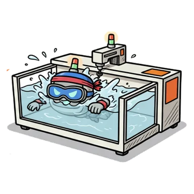</td><td><b>Wet etch and clean</b><br><sub>14 groups, 112 tools</sub></td><td>Cleans and strips wafers in chemical baths. Visited more than any other area.</td><td>Laps in its own tank</td></tr>
<tr><td></td><td><b>Diffusion</b><br><sub>10 groups, 75 tools</sub></td><td>Furnaces that bake big batches for hours. Few visits, long waits for a batch to fill.</td><td>Hot yoga, waiting for the class to fill</td></tr>
<tr><td>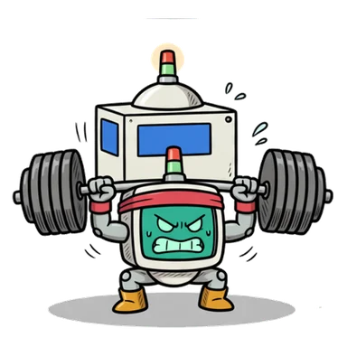</td><td><b>Dielectric</b><br><sub>10 groups, 59 tools</sub></td><td>Lays down the insulating films between wiring layers.</td><td>Squat with plates stacked in layers</td></tr>
<tr><td></td><td><b>Thin film</b><br><sub>11 groups, 90 tools</sub></td><td>Deposits metal and other thin films.</td><td>Kettlebell swing under a veil of chalk</td></tr>
<tr><td></td><td><b>Thin film metrology</b><br><sub>2 groups, 4 tools</sub></td><td>Measures how thick each film came out. Only four in the whole fab.</td><td>Tiny curls on a bathroom scale</td></tr>
<tr><td>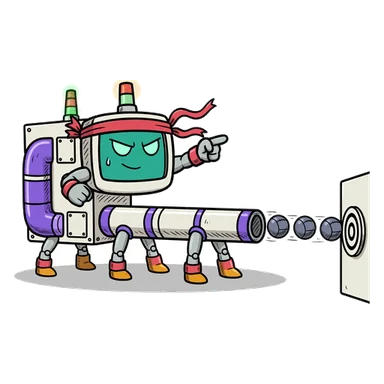</td><td><b>Ion implant</b><br><sub>9 groups, 35 tools</sub></td><td>Fires ions into the wafer to set where it conducts.</td><td>Medicine-ball launcher</td></tr>
<tr><td>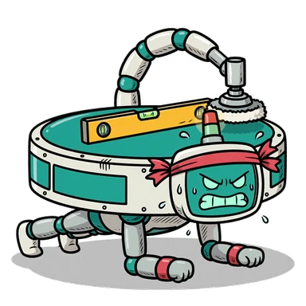</td><td><b>Polishing (CMP)</b><br><sub>6 groups, 34 tools</sub></td><td>Polishes each layer flat. The tightest group on the model: it sets the fab's speed limit.</td><td>The plank, spirit level on its back</td></tr>
<tr><td></td><td><b>Defect inspection</b><br><sub>7 groups, 16 tools</sub></td><td>Scans for particles and defects, and decides which lots get held.</td><td>Spotting the bench press</td></tr>
<tr><td></td><td><b>The wafer</b></td><td>What the whole fab exists to finish: 25 of them ride in each lot.</td><td>The drill coach</td></tr>
</table>

### Ten moods, read from the run

A machine's mood is what the simulator recorded for it at that moment: productive, standby, scheduled down or unscheduled down, the reason, and whether its finished lots are waiting for a vehicle. Here is the CMP robot in all ten.

<table>
<tr>
<td align="center">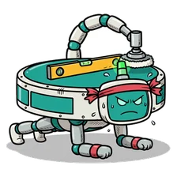<br><sub><b>In the zone</b><br>working, normal queue</sub></td>
<td align="center">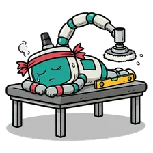<br><sub><b>Dozing off</b><br>idle, nothing waiting</sub></td>
<td align="center"><br><sub><b>Gassed</b><br>flat out, queue growing</sub></td>
<td align="center">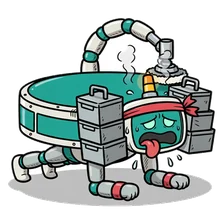<br><sub><b>Hands full</b><br>finished lots not picked up</sub></td>
<td align="center">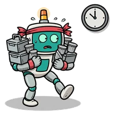<br><sub><b>Waiting for the class</b><br>batch not full yet</sub></td>
</tr>
<tr>
<td align="center"><br><sub><b>Changing kit</b><br>setup change</sub></td>
<td align="center"><br><sub><b>Rest day</b><br>planned maintenance</sub></td>
<td align="center"><br><sub><b>Pulled a muscle</b><br>a breakdown starts</sub></td>
<td align="center">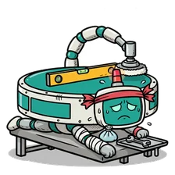<br><sub><b>At the physio</b><br>under repair</sub></td>
<td align="center"><br><sub><b>Benched</b><br>held after a defect finding</sub></td>
</tr>
</table>

Every machine has the same ten (`web/cast/<machine>/<mood>.webp`; names and signals in `web/cast/cast.json`). How idle counts as dozing and how busy counts as gassed are still to be set.

### The lots have moods too

A lot is a pod of 25 wafers. Its mood is what the simulator knows about it.

<table>
<tr>
<td align="center"><br><sub><b>Fresh recruit</b><br>just released</sub></td>
<td align="center"><br><sub><b>In line</b><br>queued</sub></td>
<td align="center"><br><sub><b>Losing patience</b><br>waited too long</sub></td>
<td align="center"><br><sub><b>Hot lot</b><br>top priority, and knows it</sub></td>
<td align="center"><br><sub><b>On the clock</b><br>time limit running</sub></td>
<td align="center"><br><sub><b>Missed the clock</b><br>time limit broken</sub></td>
</tr>
<tr>
<td align="center"><br><sub><b>On the bench</b><br>being processed</sub></td>
<td align="center"><br><sub><b>Riding the rail</b><br>in transport</sub></td>
<td align="center"><br><sub><b>Waiting for the class</b><br>batch filling</sub></td>
<td align="center"><br><sub><b>Do-over</b><br>sent back for rework</sub></td>
<td align="center"><br><sub><b>Quarantined</b><br>on a defect hold</sub></td>
<td align="center"><br><sub><b>Graduate</b><br>finished</sub></td>
</tr>
</table>

## Build your own fab

SMT2020 is one fab. In the **Build** page you lay out your own and the simulator judges it, as a game: four challenges and a free build, each run scored the moment you stop drawing.

<p align="center">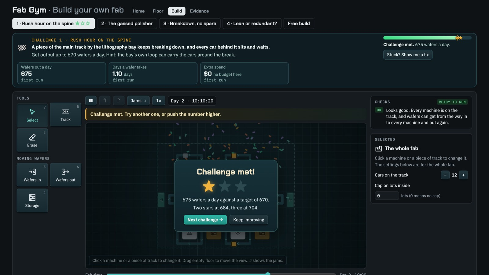</p>
<p align="center"><sub>Challenge 1 met: one star of three, with what the next two need. A teaching fab of our own.</sub></p>

- **Draw on paper.** Grid paper all round; the floor grows when you draw past its edge. Undo, zoom, box select, copy and paste, and keys for every tool.
- **See the jam.** A machine wears a badge only when something is wrong; lots waiting pile up on it; jammed track turns thick and red. Press J and only the waits glow.
- **Know your first move.** Each challenge rings its trouble spot, and one line of advice above the map changes with the hour on screen.
- **See your change work.** The simulator reruns 250 ms after you stop drawing; the result floats up where you changed something, cleared jams flash, and holding H shows the last run's jams.
- **Earn stars.** Meet the target for one; beat it by 2% for two, by 5% for three.

Under it:

- **One file for any fab** (`docs/FAB-FILE.md`). Tool types with counts and prices, rail points and one-way links with lengths (splits, merges, zig-zags), where each tool stands and loads, stockers, and where wafers enter and leave. `fabsim fab-export` writes today's campus as one: 1,249 rail points, 1,318 links, 1,043 tool stops.
- **Failure and recovery, your way** (`docs/OVERRIDES.md`). A small JSON file changes breakdowns, maintenance and recovery for a tool group, a single tool or a rail stretch: random breakdowns or wear by wafer count, maintenance on a calendar or by wafers, repair in place, swap to a spare, or hold the lots a tool just finished. An empty file is today's fab exactly; the golden logs prove it.

On the way, a finding: on today's campus no stretch of rail has a way round. Each of the 158 stretches that leaves a split cuts part of the track off when it breaks. Challenge 1 is that problem in miniature.

## What we found, and how we checked

The **Evidence** page leads with four findings in plain words, each with how sure we are; the tables and every run sit below it as the lab notebook.

<p align="center">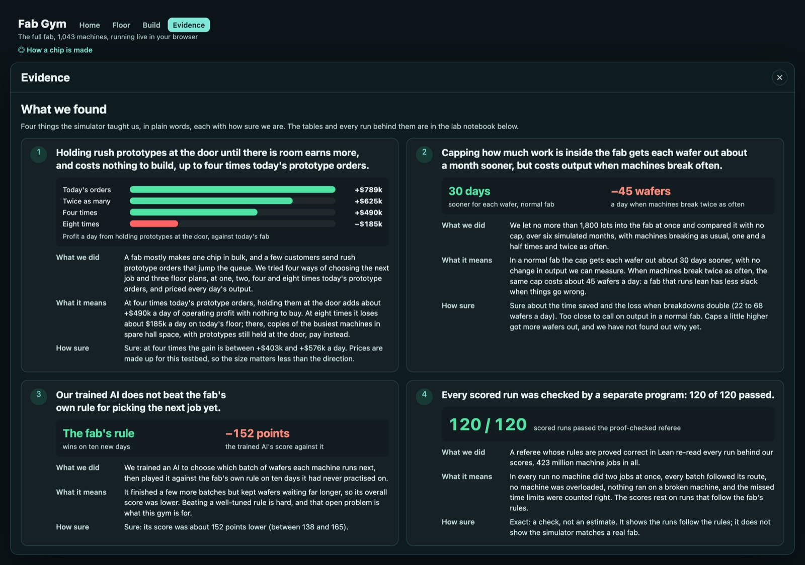</p>

**Every scored run is checked.** The simulator writes a receipt for each run: every job, every machine state, every breach. A referee written in Lean 4 reads it and checks five rules: no machine does two jobs at once, every lot follows its route, no batch is overfilled, nothing runs on a broken machine, and the breaches counted match. Its proofs say that whenever it answers yes, the five rules hold. All 120 scored runs of the long study passed, about 423 million jobs, and tampered copies are rejected (`docs/LEAN-CHECK.md`). A yes shows a run follows the fab's rules; it does not show the simulator matches a real fab.

## The machine that answers questions

1. You ask in plain words.
2. A Meta Muse Spark model turns the question into a scenario that must pass a schema, every value marked *said* or *assumed*. Ideas and trials use `muse-spark-1.3-contributor`; every run shown in this entry uses Muse Spark Open, the open-weights model. Each answer's cost is counted from its token usage, under a spending cap.
3. It proposes rules (small Rust functions), caps on work in the fab, spare tools or release plans.
4. Each rule is compiled to WebAssembly and run in a sandbox; the model reads its scores on training seeds and rewrites it.
5. Finalists are scored once on held-out seeds against today's rule, with paired intervals.
6. A card quotes only the scorer's numbers, and a person signs.

<details>
<summary>The engine room</summary>

A discrete-event simulator in Rust that reproduces the reference engine's event log bit for bit, about 0.03 s per simulated day on one laptop core; overhead vehicles on the building's drawn rails; a WebAssembly sandbox with no imports, 64 MiB and a fuel limit per decision; and a design for running beside a real fab's MES and dispatcher (`docs/SYSTEM-DESIGN.md`).
</details>

## Map of the repo

| Where | What lives there |
| --- | --- |
| `crates/fabsim/` | The simulator: the fab, the overhead vehicles, the scorer, regret and uncertainty |
| `crates/fabrule/` | The sandbox that compiles a written rule to WebAssembly and runs it |
| `crates/fabweb/` | The same simulator built for the browser |
| `agent/` | The ask loop, the learned policy and the contests |
| `web/` | The floor page |
| `web/cast/` | The cast: machines, their ten moods, the lots, and `cast.json` |
| `viz/` | The building: plans, the BIM model, Blender and Godot scenes |
| `docs/` | Every design, written before its code, with its results below the line |
| `results/` | Every run behind every number |
| `golden/` | Event logs the simulator must reproduce exactly |

## What is new in this hackathon

**Everything in this repository was built during the hackathon, starting after the 12:00 PM ET kickoff on 26 October 2026.** The git history is the record.

Built before the hackathon, and kept outside this repository:

- A Python reference engine for the SMT2020 testbed, written earlier in Chetnova's private repository. The Rust simulator here is written new and is checked against event logs recorded from that engine (the golden files in `golden/`). None of its code is copied here.
- Earlier results from the SMT2020 testbed (a learned dispatch rule, a WIP-cap study). They are quoted only where labelled "pre-existing".

## Credits

The SMT2020 testbed: Kopp, Hassoun, Kalir and Mönch, *SMT2020: A Semiconductor Manufacturing Testbed*, IEEE Transactions on Semiconductor Manufacturing, 2020. See `NOTICE.md`. The cast was drawn with Meta's Muse Image from our prompts (`docs/CAST-PROMPT.md`). Our entry to the [Meta Global AI Developer Hackathon](https://cerebralvalley.ai/e/meta-ai-developer-hackathon), Indie track. By Chetnova.
