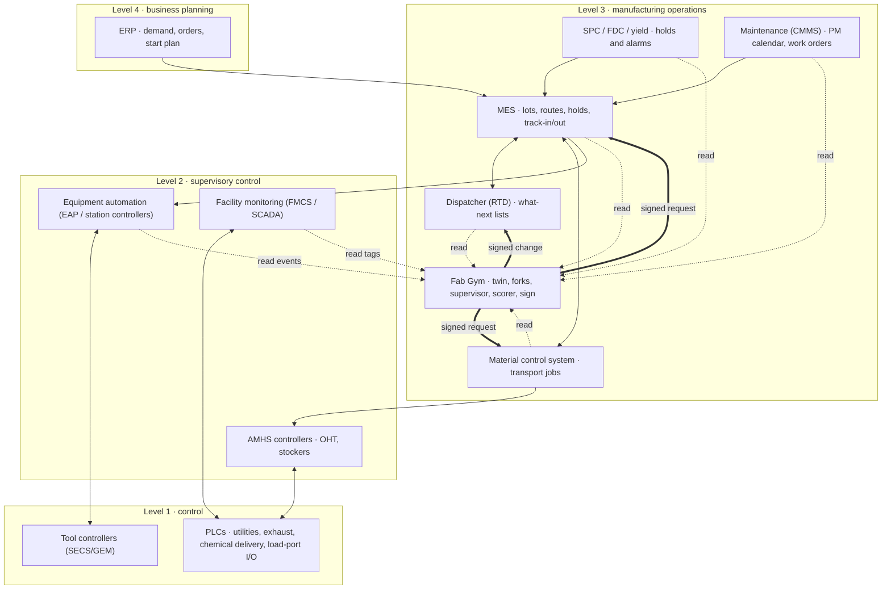

# Fab Gym in a real fab: the system design

Written 30 October 2026 at the founder's request: the full-scale system the hackathon entry points at, designed so a
fab could build it. Status marks on every part:

- **Built**: runs today, from the SMT2020 testbed (a published set of a fab's tool groups, routes and times; no real fab's data).
- **Planned**: in the hackathon plan (`docs/NARRATIVE.md`), not yet built.
- **Design**: how it would connect to a real fab. Not built, not run against any real fab or real equipment.

Standards are named from general knowledge of SEMI, IEC and ISA documents; the current editions must be read before
an integration is built. Message names and remote-command names in the examples are illustrative: each tool's own
GEM manual defines what it accepts. Agents propose, the simulator scores, a person signs, and the fab's own systems
execute.

---

## 1. The story we are hinting at

Today Fab Gym is a gym. Someone asks a question about the SMT2020 fab in plain words, a language model turns it into
experiments, the simulator scores every candidate against today's rule on the same random draws, and a person signs
the answer. Every number on the card comes from the scorer.

The same loop, pointed at a real fab, becomes a co-pilot for the people who run it:

1. **The fab, mirrored.** Fab Gym reads the fab's own records (lots, routes, tool states, maintenance, transport
   moves) and compiles them into the same model format the SMT2020 fab uses today. It replays last month and shows how
   closely the twin matched what happened, with intervals.
2. **The fab, as it stands now.** Every few hours it takes a snapshot of the live floor: every lot at its step, every
   tool in its state, every carrier on the track.
3. **Many futures from now.** It forks that snapshot into many copies, each with its own luck (breakdowns, process
   times), and plays each candidate policy forward for days.
4. **A proposal with its evidence.** A supervisor (a language model, or a plain search) proposes the top-level policy
   for the next few hours: the dispatching rule and its weights, how much work to release, which lots to expedite.
   The proposal arrives with the forks' result, paired against doing nothing, with 95% intervals.
5. **A person decides.** The shift lead or the industrial engineer signs it, or does not.
6. **The fab's own systems carry it out.** Fab Gym renders the signed change into the format the fab's dispatcher,
   MES or transport controller already accepts, and hands it to them. It never drives a tool itself.
7. **It checks itself.** After the change, it compares what happened with what the forks said would happen, and
   recommends a rollback when they part.

What we learned from the SMT2020 testbed shaped this design:

- **Judge over days, from the fab as it is.** A 3-day window starting from a full fab hid how badly FIFO and the
  learned PPO policy do; over 60 settled days they lose about half the output (`docs/LONG-RESCORE.md`). Picking the
  best rule for each 12-hour shift by that shift's own result did worse than never switching, by about 2,200 reward
  (95% 1,600 to 2,770). So the supervisor scores each proposal over days of look-ahead, never over the next shift
  alone.
- **The incumbent is strong.** From the SMT2020 testbed today's rule (priority, then no setup change, then oldest) beat
  every alternative on all ten held-out seeds and sat about 39 wafers a day below the capacity ceiling. A system that
  ships changes because a model likes them would make things worse. Fab Gym ships a change only when it wins on forks
  of the fab's own state, by an interval that excludes zero.
- **Speed is not the issue.** A rule picks inside the engine in 34 ns to 20 µs; a simulated day takes about 0.03 s on
  one laptop core. The hard part is trust, so the design spends its effort there.

Why we built it this way: a fab will not hand its floor to a model, and it should not. It will consider a change it
can see tested on its own fab, scored by a simulator it can rerun, signed by a person it knows, and carried out by
the systems it already trusts. Everything below serves that.

---

## 2. Principles

1. **Agents propose, the simulator scores, a person signs, the fab's own systems execute.** No model output reaches
   the floor without a score and a signature.
2. **Read before write.** Every integration starts read-only. Writes come later, one system at a time, each behind the
   fab's change control.
3. **No model in the hot path.** Lot-by-lot dispatch stays in the fab's dispatcher, or in a compiled rule that answers
   in microseconds. Language models work on the scale of hours: proposing, explaining, critiquing.
4. **Fail to the incumbent.** If Fab Gym stops, faults or is switched off, the fab runs on the rule it ran before.
   Inside the gym this already holds: a written rule that faults falls back to today's pick.
5. **Every claim carries its evidence.** Paired seeds, 95% intervals, the run's hashes, a certificate that the
   simulated schedule obeyed the model's rules. Any result can be rerun bit for bit from its inputs.
6. **Bounded authority.** An allowlist of actions, each with limits (which tool groups, how far a WIP cap may move,
   for how long), a kill switch, and a record of who signed what.
7. **The fab's data stays in the fab.** On-premises, able to run with no outside network; a language model is optional
   and can run locally.
8. **Say "cannot say".** Where the fab's data cannot support a number, the system says so and leaves the number out.

---

## 3. Where it sits

Fab Gym lives at ISA-95 level 3 (manufacturing operations), beside the MES and the dispatcher, as an advisor and
scorer. It reads from levels 2 and 3, and it writes only through level-3 systems that already own each decision.



Solid double arrows are writes, and each comes later than the reads (section 7). Fab Gym never connects to a tool
controller or a PLC for writing.

---

## 4. The components

| # | Component | Its job | Status |
| --- | --- | --- | --- |
| 1 | Connectors | Read the fab's records and live events into one event log | Design |
| 2 | Model compiler | Turn master data into a shop model (`fabgym-shop 1`) | Built for SMT2020; design for a fab's MES |
| 3 | Calibration and validation | Fit times and failure rates; replay history and publish how well the twin matched | Design |
| 4 | Snapshot | The live floor as a starting state | Built as a format (SMT2020's 2,255 lots in progress); design for live MES |
| 5 | Simulator core | Discrete-event fab, transport fleet, defect holds; pause, copy, continue | Built |
| 6 | Policy library and sandbox | Rules, learned policies, WIP caps, release plans, layout variants | Built |
| 7 | Supervisor | Every few hours, propose the top-level policy, scored over days on forks | Planned |
| 8 | Scorer and gate | Paired seeds, intervals, guardrails, certificates | Built (certificates planned) |
| 9 | Sign and change record | Signature over the question, scenario and report | Built; design for a fab's change control |
| 10 | Command generator | Render a signed change into each target system's own format | Design |
| 11 | Monitor and rollback | Compare what happened with the forecast; recommend a rollback | Design |
| 12 | Explanation | The floor page, the numbers, the colleague, the ask box | Built (colleague planned) |

### 4.1 Connectors (design)

One adapter per source, each read-only, each writing timestamped events into one append-only log (an event bus such
as Kafka, or MQTT with Sparkplug B for plant tags), with an export to OCEL 2.0 for process mining.

- **MES**: lot master, routes and steps, recipes, qualification (which tool may run which step), holds and releases,
  track-in and track-out, priorities, the start plan. Through the MES's own API, database views or ISA-95 messages
  (B2MML).
- **Equipment**: state changes and events from the equipment automation layer, which already speaks SECS/GEM to the
  tools: event reports, alarms, status variables, process and control jobs, carrier and substrate tracking. Fab Gym
  subscribes to what the EAP already collects; it does not open its own sessions to tools.
- **Transport (AMHS)**: every transfer: carrier, from, to, vehicle, queued, assigned, picked, delivered; stocker
  in and out; load-port hand-offs.
- **Maintenance**: preventive maintenance calendars (by time and by wafer count), work orders, actual durations.
- **Quality**: SPC and FDC alarms that put tools or lots on hold, and their release.
- **Facilities**: read-only tags from the facility monitoring system and its PLCs: ultrapure water, exhaust, clean dry
  air, chillers, power quality, cleanroom pressure and particles. These are the likeliest cause of the correlated
  failures the supervisor is meant to find (section 4.7).

Every event carries its source time and its arrival time. Clocks are synchronised (PTP or NTP; SEMI E148 on the
equipment side).

### 4.2 Model compiler (built for SMT2020; design for a fab)

Today `fabsim::smt2020::load` reads the SMT2020 files into the shop format, and the layout and fleet commands add the
building: halls, bays, each tool's port, the drawn rails, stockers and the vehicle fleet. For a fab, the same records
are filled from MES master data:

| Shop record | Filled from |
| --- | --- |
| `group` (tool count, load and unload, breakdowns, PM by time and by wafers) | Equipment master, E10 history, the CMMS calendar |
| `route` and `step` (group, per piece, lot or batch, time, batch sizes, setup, sampling, queue-time limits) | Routes and recipes, recipe times, sampling plans, Q-time rules |
| qualification families | The qualification matrix (tool by recipe) |
| `release` | The start plan |
| `fleet`, `port`, `bayrail` | AMHS layout and vehicle count |
| defects (hold a tool H minutes, look back L, hold lots R) | SPC and FDC hold rules |

Anything missing stays missing: the compiler lists every value it had to assume, and the validation card shows it.

### 4.3 Calibration and validation (design)

- **Fit.** Processing times by recipe and tool from track-in and track-out; time between failures and time to repair
  by tool from state history; PM lengths; transport times by origin and destination from the AMHS log; how often SPC
  and FDC holds fire.
- **Backtest.** Start the twin from a past snapshot, feed it the releases that actually happened, and run it forward
  a month on many seeds. Compare, with intervals: moves a day by tool group, WIP by area, cycle time by product, outs
  a day, queue-time breaches, transport delay.
- **Validation card.** Published before any recommendation is shown: what matched within the interval, what did not,
  and which questions the twin therefore cannot answer yet.
- **Recalibrate** on a schedule and whenever monitoring (4.11) sees drift.

### 4.4 Snapshot (built as a format; design for live MES)

The engine already starts from a state: SMT2020 ships 2,255 lots in progress, each at its step, and the run picks up
from there. A live snapshot is the same thing filled from the MES at time t: every lot's step, location, hold and
priority; every tool's state and setup; every carrier on the track. The `Stepper` already pauses a run, copies it and
continues each copy, so forks of a snapshot need no new engine work.

### 4.5 Simulator core (built)

`crates/fabsim`, in Rust. Measured from the SMT2020 testbed on one core of an M1 laptop:

- a simulated day in 0.026 to 0.029 s, about 276,000 dispatch decisions a second;
- the reference engine's event log reproduced bit for bit; raw processing times within 1% of the published reference;
- the same answer twice from the same seed, so any result can be rerun exactly;
- the transport fleet: vehicles on the drawn two-rail loops, stretches with a capacity and a headway, hoists held at
  ports, detours when a stretch is full, full ports blocking tools;
- defect holds; WIP caps; breakdowns and maintenance by time and by wafer count; batches, setups, sampling,
  queue-time limits, hot lots;
- `Stepper`: pause, copy, continue, used by the regret audits.

The fleet's hoist step corresponds to the load-port hand-off a real AMHS performs under SEMI E84 (the parallel I/O
signals VALID, CS_0, L_REQ or U_REQ, TR_REQ, READY, BUSY, COMPT and HO_AVBL). Tool states map onto SEMI E10 states:
working to productive, idle to standby, changing setup and maintenance to scheduled downtime, broken to unscheduled
downtime. The mapping is to be confirmed against each fab's own E10 implementation.

### 4.6 Policy library and sandbox (built)

- **Built-in rules**: today's rule, FIFO, shortest processing first, critical ratio, random.
- **Written rules**: one Rust function that scores each candidate, written by a person or a model. It is refused
  before compiling if it reaches outside itself, compiled to WebAssembly and run in wasmtime with no imports, at most
  64 MiB, a fuel limit per decision and at most 4,096 candidates. A rule that faults falls back to today's pick; a
  rule that faults on more than 1% of decisions is not eligible.
- **Learned policies**: PPO today, through a Python harness; exported to ONNX and run in Rust for a fab (design).
- **Top-level levers**: WIP caps (CONWIP), release plans, hot-lot priorities, spare tools and layout variants with
  their capital cost.

### 4.7 Supervisor (planned)

Every few hours (6 by default, set by the fab):

1. Take a snapshot (4.4) and read what happened since the last one.
2. Propose candidates: keep the current policy; switch the dispatching rule or its weights; move the WIP cap; delay
   or advance releases; expedite or relax hot lots. A language model may propose and explain; a plain search may too.
3. Score each on K forks of the snapshot over a look-ahead of days (the D result says hours are too short), the rule
   underneath playing every pick, paired against keeping the current policy.
4. Keep only candidates that win by an interval that excludes zero and pass every guardrail (4.8); send the best to
   a person with its evidence.

**The founder's thesis** (29 Oct): reading the fab every few hours, an agent can find failures that depend on load or
come together, which no dispatching rule sees. SMT2020's breakdowns run on the clock, independent of load, so the
gym will plant load-dependent and correlated failures in an optional failure model and test whether the supervisor
finds them blind. In a real fab the facility tags (4.1) are where such patterns would show: an exhaust fault that
takes down a bay, a chiller that trips under load.

### 4.8 Scorer and gate (built; certificates planned)

- Paired seeds, the same random draws for every candidate; 95% t-intervals; Bonferroni when many options are
  compared; candidates picked on training seeds and scored once on held-out seeds fixed in advance.
- Long windows from a settled state: protocol long-v1 is 130 days of warm-up and a 60-day window.
- Guardrails, each a hard check: queue-time breaches no worse than the incumbent within a stated tolerance; hot-lot
  cycle time; no product starved; no tool group over its capacity ceiling.
- Every measure kept per run (`runs.tsv`, `policies.json`), with each policy's own time per pick.
- Certificates (planned): a Lean checker confirms each scored run is a valid schedule (no tool runs two lots at once,
  every lot follows its route, batches within size, nothing on a downed tool, breach count right) and rejects a
  tampered copy. This proves a run obeys the model's rules and says nothing about how closely the model matches a fab.

### 4.9 Sign and change record (built; design for a fab)

Today a signature stores the SHA-256 of the question, the scenario and the report, and a signed card stays valid only
while all three still match. In a fab the signature goes into the fab's own change control (management of change):
named roles, a second signer for anything that writes to a system, an expiry, and the evidence attached.

### 4.10 Command generator (design)

A signed change is one **change bundle**: what changes, where, for how long, the evidence, the signatures. The
generator renders it into the format each target already accepts, shows the rendering for review (a dry run), and
hands it to that system's own interface. Nothing is sent automatically until level 5 of the rollout (section 7), and
then only inside an envelope people approved.

An illustrative bundle:

```json
{
  "bundle": "cb-2026-11-02-0600-cmp",
  "valid": {"from": "2026-11-02T06:00", "to": "2026-11-02T18:00"},
  "changes": [
    {"target": "dispatcher", "scope": {"tool_group": "CMP-79"}, "rule": "incumbent", "weights": {"setup_change": 2.0}},
    {"target": "mes", "action": "wip_cap", "value": 1800, "unit": "lots in the fab"},
    {"target": "mes", "action": "hold_release", "product": "P4", "minutes": 360}
  ],
  "evidence": {"forks": 20, "look_ahead_days": 7, "against": "keep current policy",
               "wafers_per_day": {"mean": 14.2, "lo": 3.1, "hi": 25.3}, "runs_sha256": "..."},
  "fallback": "incumbent policy",
  "signed_by": ["shift lead", "industrial engineer"]
}
```

The numbers in the bundle are made up to show the shape.

| Target | What the generator writes | Through |
| --- | --- | --- |
| Dispatcher (RTD) | A rule configuration change, or the compiled rule as a callable the dispatcher asks for its what-next list | The dispatcher's rule repository and its change control |
| MES | Requests: hold or release, priority change, start-plan change, WIP cap | The MES API or ISA-95 messages (B2MML) |
| Transport (MCS) | Transfer requests: pre-stage a carrier at a stocker near the tool that will need it | The MCS host interface (SEMI E82, E88, E153 on the AMHS side) |
| Equipment | Only on a tool owner's request: host commands rendered as SECS-II messages for the EAP to send (remote commands S2F41 or S2F49, process jobs under E40, control jobs under E94, carrier actions S3F17 under E87) | The EAP, never Fab Gym directly |
| Facilities and PLCs | Nothing by default. On request, a proposed setpoint rendered as an OPC UA write request (IEC 62541), a Modbus TCP register write, or a parameter block for an IEC 61131-3 controller, for the facility team to apply under their own interlocks | The facility's control system |

An equipment command, rendered for the EAP (illustrative; the remote-command name and its parameters come from the
tool's GEM manual):

```text
S2F41 W                      * Host Command Send
<L[2]
  <A "PP-SELECT">            * RCMD, as the tool's GEM manual names it
  <L[1]
    <L[2] <A "PPID"> <A "RECIPE-07">>
  >
>
```

A facility proposal, rendered as an OPC UA write (illustrative; the node id is the facility's own):

```text
WriteRequest
  NodeId:      ns=3;s=Exhaust.Bay07.Fan2.SpeedSetpoint
  AttributeId: Value
  Value:       Float 82.5      (percent; current 78.0)
  Requested by bundle cb-2026-11-02-0600-cmp, signed by the facility engineer, applied by the FMCS
```

The point of the generator is that a person reviews the exact message a system will receive, alongside the evidence,
before anything is sent.

### 4.11 Monitor and rollback (design)

After a change goes live, Fab Gym keeps the forks' forecast and compares it with what happens: moves a day by group,
WIP, cycle time, breaches. When the realised numbers leave the forecast's interval, it raises a drift alarm,
recommends a rollback to the incumbent, and recalibrates. Rollback is one signed bundle that restores the previous
configuration.

### 4.12 Explanation (built; the colleague planned)

The floor page draws the fab in 2.5D from the building's own geometry, with every tool in the simulator's state,
every vehicle with its lot, a lot followed through all its steps, and the Numbers and Change panels. The ask box turns
a question into a scenario through a language model and scores it natively. In a fab the same views show the live
snapshot and each proposal's forks.

---

## 5. Interfaces at a glance

| System | Standard or protocol | Direction | What flows | Rollout level |
| --- | --- | --- | --- | --- |
| MES | Vendor API, database views, ISA-95 / IEC 62264 messages (B2MML) | Read, then requests | Lots, routes, holds, moves; later hold, release, priority, WIP cap | 1, then 4 |
| Dispatcher (RTD) | Its rule repository; what-next calls | Read, then configuration | Rules in use, what-next lists; later rule changes | 1, then 4 |
| Equipment (via EAP) | SEMI E5 SECS-II over E37 HSMS, E30 GEM; E40, E94, E87, E90; E10 and E116 states | Read | Events (S6F11), alarms (S5F1), status (S1F3), jobs, carriers, wafers | 1 |
| Equipment data | Interface A / EDA (SEMI E120, E125, E132, E134) | Read | High-rate tool data for FDC and the defect model | 2 |
| Transport | SEMI E82, E88, E153 (host to AMHS); E84 (load-port hand-off) | Read, then requests | Transfers, stocker moves, hand-off times; later pre-staging | 1, then 4 |
| Maintenance | CMMS API | Read, then requests | PM calendars, work orders; later proposed PM timing | 1, then 4 |
| Facilities | OPC UA (IEC 62541); Modbus TCP, EtherNet/IP, PROFINET through a gateway; IEC 61131-3 controllers | Read | Utility and cleanroom tags | 2 |
| Event log | Kafka or MQTT with Sparkplug B; OCEL 2.0 export | Internal | Every event, timestamped | 1 |
| Time | PTP or NTP; SEMI E148 | Read | Clock alignment | 1 |
| Security | IEC 62443 zones and conduits; SEMI E187 and E188 on the equipment side | All | Read-only conduits first; no inbound path from Fab Gym to level 1 | All |

---

## 6. Running it

- **Deployment.** Containers on servers inside the fab's network. The simulator is one Rust binary; forks run in
  parallel, one per core. The language model, if used, runs on a local server or not at all.
- **Availability.** Fab Gym is outside the dispatch path, so its downtime costs advice and nothing else: the fab runs
  on its incumbent rule. A written or learned rule placed inside the dispatcher keeps the sandbox's fallback to the
  incumbent pick.
- **Security.** Read-only conduits from levels 2 and 3 (a data diode where the fab wants one); writes only to level-3
  systems through their own APIs and change control; no path to level 1; signed, versioned rules; the sandbox for any
  code a model writes.
- **Audit.** Every snapshot, fork set, proposal, rendering, signature and outcome kept with its hashes, and
  replayable.
- **Speed.** Measured from the SMT2020 testbed on an M1 laptop: a simulated day in about 0.03 s per core; 60 days of
  shift-by-shift switching across five rules in 35 to 42 s per seed. Twenty forks of a week's look-ahead fit easily
  in a supervisor's hours-long cycle on one multi-core server (design estimate from these timings).

---

## 7. The rollout ladder

| Level | Name | What happens | Exit when |
| --- | --- | --- | --- |
| 0 | Gym | Everything from the SMT2020 testbed | Built |
| 1 | Mirror | Read-only connectors; the model compiled from the fab's master data; calibrated; backtested | The validation card shows the twin within its intervals on the measures that matter |
| 2 | Shadow | Live snapshots; the supervisor proposes; nobody acts; each proposal's forecast kept and compared with what the fab did | Proposals would have helped, measured over weeks, with intervals |
| 3 | Advise | Proposals go to the shift lead and the industrial engineers with their evidence; people carry out what they sign through their usual systems | People act on them, and outcomes match forecasts |
| 4 | Assisted write | Signed bundles rendered and sent to the dispatcher, MES or MCS through their change control; one tool group or one product first; switchback trials (alternate shifts or days) measure the effect with intervals | The effect holds on the real floor |
| 5 | Bounded autonomy | Inside an envelope people approved (rules from a signed library, a WIP cap range, limits on how often it may switch), the supervisor applies changes on its own, each logged, with a kill switch | The envelope is renewed by people on a schedule |

A fab can stop at any level and keep what it has.

---

## 8. What a fab supplies, and what we have not shown

A fab supplies access to its MES, dispatcher, AMHS and maintenance records; its GEM manuals and E10 conventions; its
change-control process; and people who can say which numbers matter.

What Fab Gym has not shown:

- It has never run on a real fab's data. Every result so far is from the SMT2020 testbed.
- The model tracks lots of 25 wafers, has no operators walking between tools, no yield and no chemistry, and treats a
  stretch of rail as a queue with a capacity and a headway.
- The supervisor, the failure model it is meant to find, the Lean certificates, the connectors, the calibration and
  the command generator are planned or designed; none of them is built yet.
- The interface examples are illustrative; real message sets come from each system's documentation.

---

## 9. Deliverables for a real deployment, in order

1. A data-access agreement and a read-only conduit for MES, dispatcher, AMHS and maintenance records.
2. Connectors and the event log.
3. The model compiler on the fab's master data, listing every assumed value.
4. Calibration, the backtest and the first validation card.
5. Live snapshots and forks.
6. The supervisor in shadow, with its forecasts kept.
7. Monitoring of forecast against outcome.
8. The command generator in dry-run, rendering bundles for review.
9. The first assisted write: one tool group, one rule change, a switchback trial.
10. The envelope for bounded autonomy, if the fab wants it.
